<h3><code>hemant@github ~ $ ./contributions.sh</code></h3>

  

<h3><code>hemant@github ~ $ whoami</code></h3>

<table>
<tr>
<td valign="top"></td>
<td valign="top"></td>
</tr>
</table>

<h3>Hemant Singh</h3>

<b>Visual Designer · Branding · UI/UX · Motion Design · 3D</b>

Coventry, United Kingdom

<!-- Maintenance instructions and source attribution: SETUP.md -->
